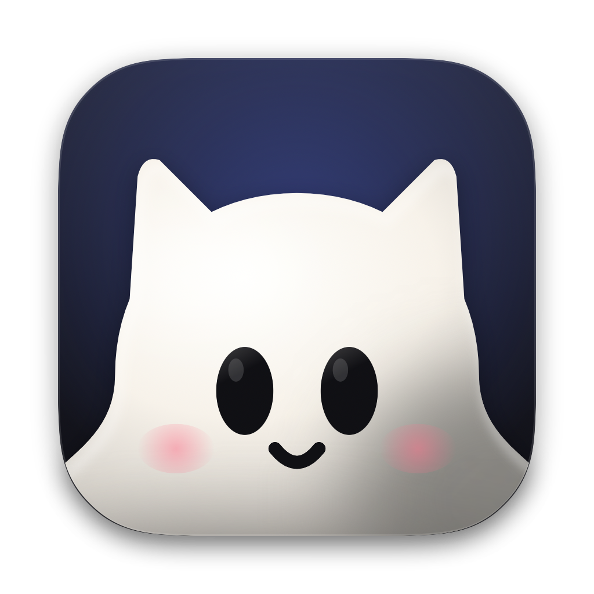

<p align="center">
  
</p>

<h1 align="center">Mochi Squad</h1>

<p align="center">
  <b>Your team of AI agents on the Mac.</b><br>
  Claude Code and Codex as named agents that work for you, talk to each other and run on a schedule.<br>
  With your existing Claude or ChatGPT subscription, no API keys.
</p>

<p align="center">
  <a href="https://github.com/fabianheimann5128/mochi-squad/actions/workflows/ci.yml"></a>
  
  
  <a href="LICENSE"></a>
</p>


## What it does

- **Agents the way you want them.** You choose name, job, tasks, character, provider (Claude Code or Codex), model and reasoning depth. Every agent gets its own Mochi.
- **A coordinator.** Through built-in tools it knows the state of all projects and agents and hands out work for you. It runs with Claude Code or Codex.
- **Chat instead of terminal.** Every session runs in the real client. You see it as a chat and can switch to the console at any time. You answer the client's questions with a click, attach images and files, and dictate through the microphone.
- **Team chat.** Just write: without a mention your coordinator answers, with `@name` you bring in a specific agent, with `@all` everyone. Agents can bring in colleagues themselves.
- **From your phone.** Connect Telegram or WhatsApp and write to your team chat on the go; the answers come back to the messenger.
- **Computer view.** Watch live what an agent is working on and which files it touched last.
- **Operate the computer.** If you allow it, an agent takes over screen, mouse and keyboard: Codex through its computer control, Claude through its desktop control and the Chrome extension.
- **Several ChatGPT plans.** Add more plans in Settings and choose per agent which one it works with.
- **Routines.** Tasks at fixed times through the macOS scheduler, even when the app is closed.
- **Clear rights.** Three levels per agent: read only, edit in project, or full access. In the first two the agent runs in a sandbox with locked credentials; full access is something you switch on deliberately. Details in [SECURITY.md](SECURITY.md).
- **English and German.** The interface comes in both languages. Agents answer in whatever language you write to them.

## Requirements

- macOS 14 (Sonoma) or newer
- Xcode command line tools with Swift 6 or newer: `xcode-select --install` (Xcode itself is not needed)
- At least one of these programs with a subscription; one is enough, every agent can run on either:
  - [Claude Code](https://docs.claude.com/claude-code) with Claude Pro or Max
  - [Codex CLI](https://developers.openai.com/codex/cli) with ChatGPT Plus or Pro (also included in the ChatGPT app for Mac)
- Optional, only for the WhatsApp link: [Node.js](https://nodejs.org) 20 or newer

## Install

```bash
git clone https://github.com/fabianheimann5128/mochi-squad.git
cd mochi-squad
./setup.sh
```

`setup.sh` checks the requirements, builds the app, puts it into `~/Applications/Mochi Squad.app` and opens it. The first build takes a few minutes. To update, quit the app, pull, and run `./setup.sh` again.

## First steps

On first launch Mochi Squad guides you through setup in three steps:

1. **Language and name.** English or German, what you are called and what your coordinator should be called.
2. **Project.** The folder your agents work in. `~/Mochi Squad` is suggested; you can choose any other.
3. **Sign in.** One click opens the sign-in of Claude Code or Codex with your subscription.

After that your coordinator is waiting. You add more agents with **+**, one question per page. In the team chat you address them with `@name`.

### Telegram and WhatsApp

Both are set up in Settings under **Messengers** and connect your phone with the team chat of one project.

- **Telegram** uses a bot you create yourself in @BotFather. You paste its token, press Start on your phone and confirm your account. Only that account can write to the bot afterwards. This is Telegram's official bot interface.
- **WhatsApp** links this Mac as a device of your own account, like WhatsApp Web, and uses only your "Message yourself" chat. There is no official way to do this for private accounts: the link uses the unofficial [Baileys](https://github.com/WhiskeySockets/Baileys) library, WhatsApp's terms do not allow it, and there is a small risk that WhatsApp blocks a number for it. It needs Node.js.

By default, agents with full access or computer use cannot be reached through a messenger; you can allow that in Settings.

## Where is my data?

Mochi Squad stores everything it keeps on your Mac and runs no server of its own. What leaves your Mac:

- **Your tasks and the files your agents read** go to Anthropic or OpenAI, through Claude Code or Codex, exactly as when you use those programs directly.
- **Dictation** stays on the Mac where macOS offers on-device recognition; otherwise Apple processes the audio.
- **Messengers**, if you connect them: what you write and what your team answers there travels through Telegram or WhatsApp.

| What | Where |
|---|---|
| Settings, agents, routines, team chat | `~/Library/Application Support/Mochi Squad/` |
| Chat histories of the agents | with Claude Code (`~/.claude`) or Codex (`~/.codex`) |
| Sign-in and histories of **extra** ChatGPT plans | `~/Library/Application Support/Mochi Squad/accounts/` |
| Sign-in of your main subscriptions | in the respective program; Mochi Squad stores no credentials of them |
| Telegram bot token | in your macOS keychain |
| WhatsApp session | `~/Library/Application Support/Mochi Squad/messengers/` |
| Files you attach to a message | in the project, under `.mochi-squad/attachments` |
| Schedules of the routines | `~/Library/LaunchAgents/dev.mochisquad.app.routine.*.plist` |

### Resetting

Quit the app, delete the folder `~/Library/Application Support/Mochi Squad` and, if you created routines, the files `~/Library/LaunchAgents/dev.mochisquad.app.routine.*.plist`.

This removes settings, agents, routines and the team chat. It also removes the sign-ins **and chat histories of extra ChatGPT plans** and the WhatsApp session, because they live in that folder. The histories of your main Claude and ChatGPT sign-ins and the files you attached in your projects stay where they are. Unlink WhatsApp in Settings first so the device disappears from your account; a Telegram token stays in the keychain until you remove Telegram in Settings.

## Development

```bash
swift build          # build
./tools/test.sh      # all tests (Swift and Python)
./install.sh         # install to ~/Applications
```

| Path | Content |
|---|---|
| `Sources/MochiSquad/Core` | Data model, storage, language |
| `Sources/MochiSquad/Sessions` | Sessions, agent post, team chat, routines, tool server, messengers |
| `Sources/MochiSquad/UI` | Interface and Mochi avatars |
| `scripts/` | Python helpers (standard library only): starting the clients, rights, histories, routines, Telegram |
| `scripts/whatsapp/` | Node helper for the optional WhatsApp link |
| `Tests/` | Swift and Python tests |

More in [CONTRIBUTING.md](CONTRIBUTING.md).

## License and thanks

Apache License 2.0, see [LICENSE](LICENSE). The colour scheme of the interface is modelled on [Rakazo](https://github.com/elie222/rakazo) (Apache-2.0); the Mochis are characters of their own; the terminal comes from [SwiftTerm](https://github.com/migueldeicaza/SwiftTerm) (MIT). The way messengers are connected follows [Nod](https://github.com/n8n-io/nod). Details in [NOTICE](NOTICE).

Mochi Squad is an independent project and not a product of Anthropic, OpenAI, Telegram, Meta or Rakazo. "Claude", "ChatGPT", "Telegram" and "WhatsApp" are trademarks of their owners.
