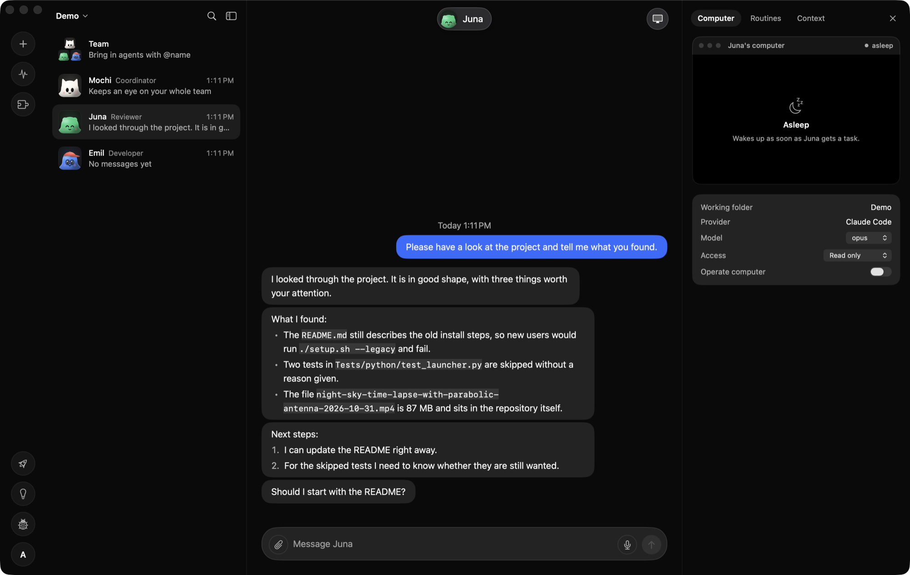

<p align="center">
  
</p>

<h1 align="center">Mochi Squad</h1>

<p align="center">
  <b>Dein Team aus KI-Agenten auf dem Mac.</b><br>
  Claude Code und Codex als benannte Agenten, die für dich arbeiten, miteinander reden und nach Plan laufen.<br>
  Mit deinem bestehenden Claude- oder ChatGPT-Abo, ohne API-Schlüssel.
</p>

<p align="center">
  <a href="https://github.com/fabianheimann5128/mochi-squad/actions/workflows/ci.yml"></a>
  
  
  <a href="LICENSE"></a>
</p>

> 🇬🇧 **Mochi Squad** is a native macOS app that turns Claude Code and Codex into a squad of named agents: chat with them, let them collaborate in a team chat, schedule routines, and keep control over what each one may do. It uses your existing Claude or ChatGPT subscription. The UI is German for now; translations are welcome.



## Was es kann

- **Agenten nach deinen Vorstellungen.** Name, Job, Aufgaben, Charakter, Anbieter (Claude Code oder Codex), Modell und Denktiefe legst du frei fest. Jeder Agent bekommt seinen eigenen Mochi.
- **Ein Koordinator.** Er kennt über eingebaute Werkzeuge den Stand aller Projekte und Agenten und verteilt Aufträge für dich.
- **Chat statt Terminal.** Jede Sitzung läuft im echten Client. Du siehst sie als Chat und kannst jederzeit in die Konsole wechseln. Rückfragen des Clients beantwortest du per Klick. Bilder und Dateien hängst du per Klick oder Ziehen an, diktieren geht über das Mikrofon.
- **Team-Chat.** Schreib einfach los: Ohne Anrede antwortet dein Koordinator, mit `@Name` holst du einen bestimmten Agenten dazu. Alle lesen den Verlauf mit und können selbst Kollegen einbeziehen.
- **Computer-Ansicht.** Sieh live, woran ein Agent arbeitet und welche Dateien er zuletzt angefasst hat.
- **Mehrere ChatGPT-Abos.** Lege in den Einstellungen weitere Abos an und wähle je Agent, mit welchem er arbeitet. Jedes Abo hat seine eigene Anmeldung.
- **Routinen.** Aufträge zu festen Zeiten über die Zeitplanung von macOS, auch wenn die App geschlossen ist.
- **Klare Rechte.** Jeder Agent läuft in einer Sandbox, bei Claude Code wie bei Codex. Schreiben darf nur, wem du es erlaubst, und Zugangsdaten bleiben gesperrt. Details in [SECURITY.md](SECURITY.md).

## Voraussetzungen

- macOS 14 (Sonoma) oder neuer
- Xcode-Befehlszeilenwerkzeuge: `xcode-select --install` (Xcode selbst ist nicht nötig)
- Mindestens eines dieser Programme mit Abo:
  - [Claude Code](https://docs.claude.com/claude-code) mit Claude Pro oder Max
  - [Codex CLI](https://developers.openai.com/codex/cli) mit ChatGPT Plus oder Pro (ist auch in der ChatGPT-App für den Mac enthalten)

## Installation

```bash
git clone https://github.com/fabianheimann5128/mochi-squad.git
cd mochi-squad
./setup.sh
```

`setup.sh` prüft die Voraussetzungen, baut die App und legt sie nach `~/Applications/Mochi Squad.app`. Der erste Bau dauert ein paar Minuten.

## Erste Schritte

Beim ersten Start führt dich Mochi Squad in drei Schritten durch die Einrichtung:

1. **Name.** Wie du heißt und wie dein Koordinator heißen soll.
2. **Projekt.** Der Ordner, in dem deine Agenten arbeiten. Vorgeschlagen wird `~/Mochi Squad`; du kannst jeden anderen wählen.
3. **Anmelden.** Ein Klick öffnet die Anmeldung von Claude Code oder Codex mit deinem Abo.

Danach wartet dein Koordinator. Weitere Agenten legst du über **+** an: Vorlage wählen oder alles selbst festlegen. Im Team-Chat sprichst du sie mit `@Name` an.

## Wo liegen meine Daten?

Alles bleibt auf deinem Mac.

| Was | Wo |
|---|---|
| Einstellungen, Agenten, Routinen, Team-Chat | `~/Library/Application Support/Mochi Squad/` |
| Verläufe der Agenten | bei Claude Code (`~/.claude`) bzw. Codex (`~/.codex`) |
| Anmeldung deiner Abos | im jeweiligen Programm; Mochi Squad speichert keine Zugangsdaten |
| Zeitpläne der Routinen | `~/Library/LaunchAgents/dev.mochisquad.app.routine.*.plist` |

Zum Zurücksetzen beendest du die App, löschst den Ordner `~/Library/Application Support/Mochi Squad` und, falls du Routinen angelegt hast, die Dateien `~/Library/LaunchAgents/dev.mochisquad.app.routine.*.plist`.

## Entwicklung

```bash
swift build          # bauen
./tools/test.sh      # alle Tests (Swift und Python)
./install.sh         # nach ~/Applications installieren
```

| Pfad | Inhalt |
|---|---|
| `Sources/MochiSquad/Core` | Datenmodell und Speicherung |
| `Sources/MochiSquad/Sessions` | Sitzungen, Agenten-Post, Team-Chat, Routinen, Werkzeugserver |
| `Sources/MochiSquad/UI` | Oberfläche und Mochi-Avatare |
| `scripts/` | Python-Helfer (nur Standardbibliothek): Start der Clients, Rechte, Verläufe, Routinen |
| `Tests/` | Swift- und Python-Tests |

Mehr dazu in [CONTRIBUTING.md](CONTRIBUTING.md).

## Lizenz und Dank

Apache License 2.0, siehe [LICENSE](LICENSE). Die Farbwelt der Oberfläche ist an [Rakazo](https://github.com/elie222/rakazo) (Apache-2.0) angelehnt; die Mochis sind eigene Figuren, das Terminal kommt von [SwiftTerm](https://github.com/migueldeicaza/SwiftTerm) (MIT); Einzelheiten in [NOTICE](NOTICE).

Mochi Squad ist ein unabhängiges Projekt und kein Produkt von Anthropic, OpenAI oder Rakazo. „Claude“ und „ChatGPT“ sind Marken ihrer Inhaber.
